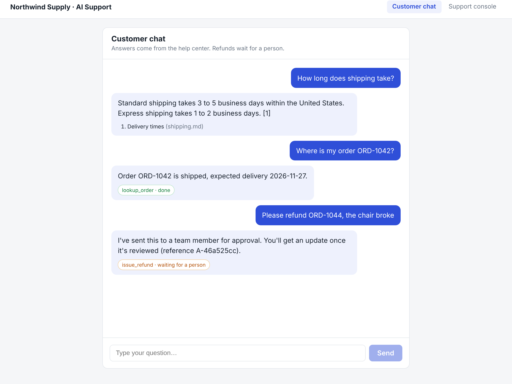
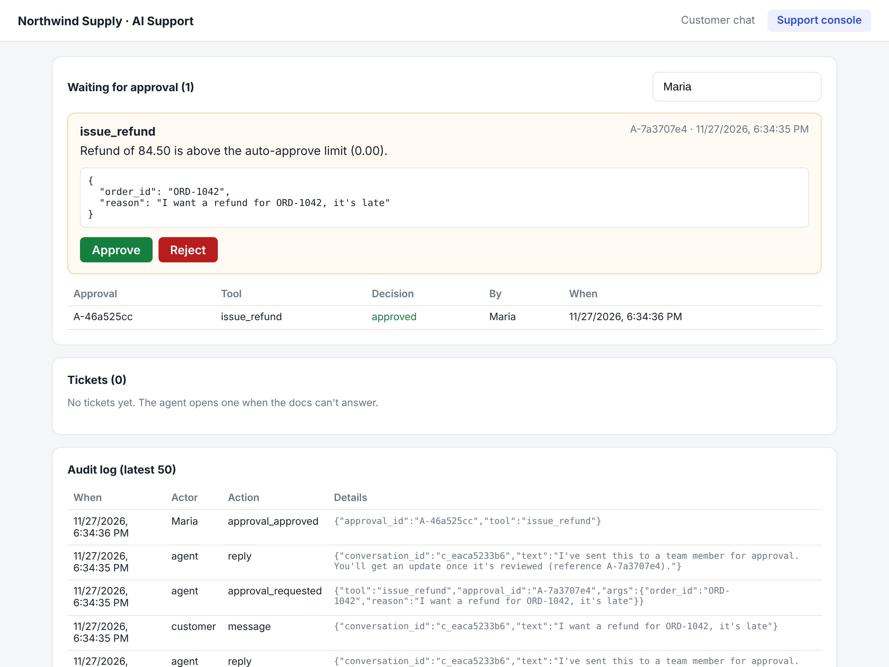

# AI Support Agent

[](https://github.com/hassan-forge/ai-support-agent/actions/workflows/ci.yml)


A customer support agent that answers from your own documents with sources, looks up orders, opens tickets, and sends anything risky (like refunds) to a person for approval before it happens.

It's a reference project showing how I build AI agents for production: the model is only one part, and most of the work is in grounding, guardrails, approvals, logging and tests.

It comes in two parts: a **FastAPI backend** (the agent, tools, approvals and audit log) and a **Next.js web app** with a customer chat and a support console where a person approves or rejects risky actions.

| Customer chat | Support console |
|---|---|
|  |  |

<sub>Screenshots use the built-in mock model, so they run with no API key.</sub>

```
POST /chat  {"message": "Please refund ORD-1044, the chair broke"}

{
  "answer": "I've sent this to a team member for approval. You'll get an update once it's reviewed (reference A-3f9c21d0).",
  "actions": [{"tool": "issue_refund", "status": "pending_approval", "approval_id": "A-3f9c21d0"}],
  "handed_off": false
}
```

## What it does

- **Answers from your docs, with citations.** Each answer cites the help-center section it came from. If the docs don't cover the question, it opens a ticket instead of guessing.
- **Uses tools.** `lookup_order` for order status, `create_ticket` for handoffs, `issue_refund` for refunds.
- **Keeps a person in the loop.** Write actions above a set limit go to an approval queue. Nothing changes until someone approves it through the API.
- **Blocks ungrounded answers.** If the model replies without a source and without a tool result, the reply is held back and the conversation goes to a person.
- **Fails safely.** Model errors, timeouts, tool loops and token budgets all end in a clean handoff, not a crash or a made-up answer.
- **Logs everything.** Every message, tool call, approval and handoff goes into an audit log.
- **Works with any model.** Claude and OpenAI work through the same small interface. A deterministic mock model lets the project run and pass its tests with no API key.

## How it works

```
customer message
      │
      ▼
 retrieve relevant doc sections (BM25 + coverage gate)
      │
      ▼
 model answers with [n] citations ──or── asks for a tool
      │                                     │
      │                     read tool ──► run now
      │                     risky write ─► approval queue ─► person approves / rejects
      ▼
 grounding check: no source and no tool? ──► ticket + handoff
      │
      ▼
 reply + audit log
```

| File | What's in it |
|---|---|
| `app/agent.py` | The agent loop, grounding check, handoffs and approval decisions |
| `app/llm.py` | Claude, OpenAI and mock providers behind one interface |
| `app/tools.py` | Tool definitions, each with a risk level and an approval rule |
| `app/retrieval.py` | BM25 retrieval over markdown with an idf-weighted coverage gate |
| `app/store.py` | Orders, tickets, approvals, conversations and the audit log |
| `app/main.py` | FastAPI endpoints |
| `web/app/page.tsx` | Customer chat: answers, numbered sources and tool-call status |
| `web/app/console/page.tsx` | Support console: approve or reject refunds, tickets, live audit log |
| `evals/` | Eval cases and a runner that scores any provider |

Retrieval is dependency-free on purpose, so the code stays easy to read. In client projects the same `Retriever.search` interface sits on top of embeddings in pgvector, Qdrant or a managed vector store.

## Run it

```bash
python -m venv .venv && source .venv/bin/activate
pip install -e ".[dev]"
uvicorn app.main:app --reload
```

Open http://localhost:8000/docs and try `POST /chat` with:

- `How long does standard shipping take?`: answers with a citation to `shipping.md`
- `Where is my order ORD-1042?`: calls `lookup_order`
- `Please refund ORD-1044`: queues a refund for approval
- `What is your CEO's name?`: not in the docs, so it opens a ticket

Approve a refund:

```bash
curl -X POST localhost:8000/approvals/<approval_id>/approve \
  -H "content-type: application/json" -d '{"reviewer": "maria"}'
```

### Web app

In a second terminal, with the API running on port 8000:

```bash
cd web
npm install
npm run dev
```

Open http://localhost:3000 for the customer chat and http://localhost:3000/console for the support console. Ask for a refund in the chat, then approve it in the console and watch it appear in the audit log. The web app forwards `/api/*` to the backend, so the API never has to be exposed to the browser directly.

### Use a real model

```bash
cp .env.example .env
# set LLM_PROVIDER=anthropic and ANTHROPIC_API_KEY, or LLM_PROVIDER=openai and OPENAI_API_KEY
uvicorn app.main:app
```

### Docker

```bash
docker compose up --build   # API on :8000, web app on :3000
```

## Tests and evals

```bash
pytest -q                 # 31 tests: retrieval, agent behaviour, API, provider request formats
python -m evals.run_evals # 13 behaviour checks; set LLM_PROVIDER to score a real model
```

The tests cover the parts that tend to break in production:

- the refund doesn't happen until a person approves it
- an answer without a source is never sent
- model errors and tool loops hand off cleanly
- unknown tools are refused
- Claude and OpenAI requests are built and parsed correctly, checked against mocked HTTP responses

CI runs lint, tests and evals on Python 3.11, 3.12 and 3.13, and type-checks and builds the web app.

## API

| Method | Path | Purpose |
|---|---|---|
| `POST` | `/chat` | Send a message, get an answer, citations and actions |
| `GET` | `/approvals?status=pending` | Actions by status: `pending` (default), `approved`, `rejected` or `all` |
| `POST` | `/approvals/{id}/approve` | Approve and run the action |
| `POST` | `/approvals/{id}/reject` | Reject the action |
| `GET` | `/tickets` | Tickets opened by the agent |
| `GET` | `/audit` | Audit log |
| `GET` | `/health` | Health check |

## Connecting it to your tools

The agent is a plain HTTP API, so it fits into what a team already uses:

- **n8n, Make or Zapier:** trigger on a new email or form, call `POST /chat`, and post the answer back, or route `handed_off: true` to a Slack channel
- **Help desk:** call it from a Zendesk, Intercom or Freshdesk webhook and post the reply as an internal note for an agent to check
- **Approvals:** use the included support console, or surface `GET /approvals` in Slack

## License

MIT
